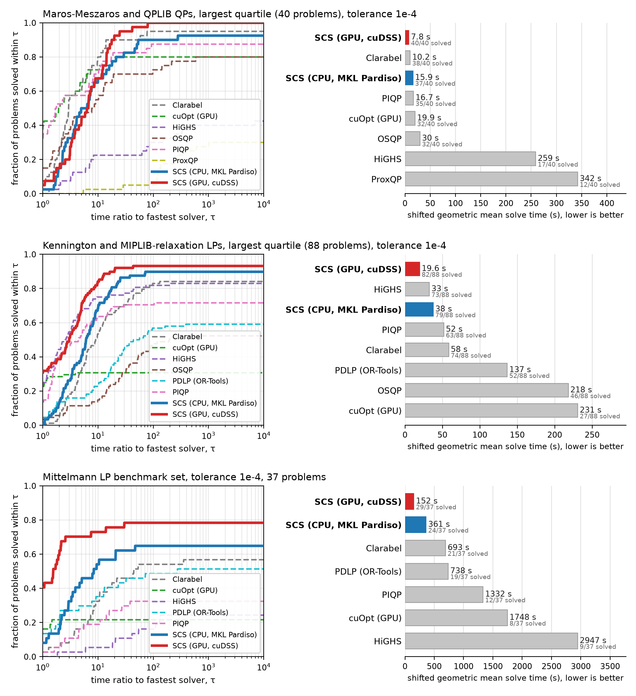
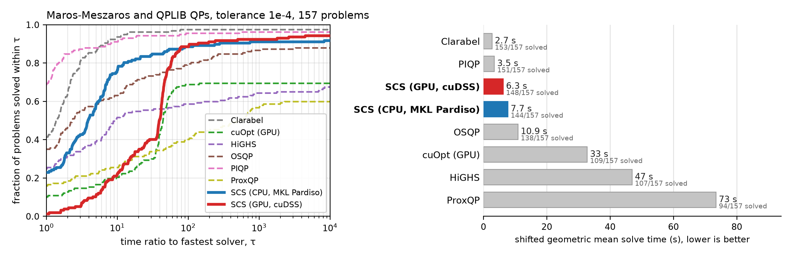
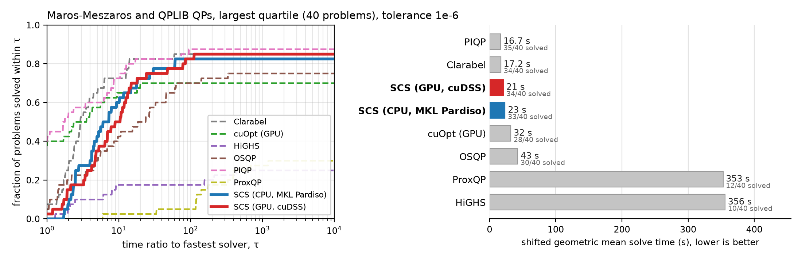
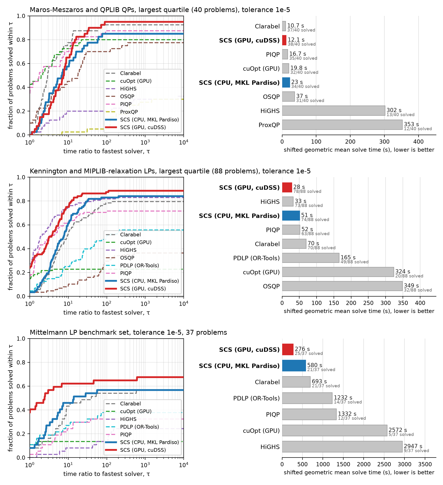

.. _benchmarks:

Benchmarks
==========

This page compares SCS 3.3 against other open-source solvers on standard
quadratic program (QP), linear program (LP) and semidefinite program (SDP)
test sets. All results were produced with the open
`solver_benchmarks <https://github.com/bodono/solver_benchmarks>`_ harness,
which feeds every solver the same problem in its native form, applies the same
time limit, and then checks every returned solution independently. The raw
results, the campaign configuration and the scripts that make the figures and
tables are in `bodono/solver_benchmarks_results
<https://github.com/bodono/solver_benchmarks_results>`_ (campaign
``scs332_2026-11``), so every number here can be regenerated.

The short version: SCS 3.3 is clearly ahead of every other first-order
solver. At a target accuracy of :math:`10^{-4}` it verifies as many of the
LPs as the best open-source interior-point codes, in less geometric mean
time, and is competitive with them on the largest quarter of the QPs; they
are faster over the full QP set, which is mostly small problems, and on the
QPs at :math:`10^{-6}`. At that target, the cuDSS GPU backend is the fastest
solver we tested on the largest quarter of the QP problems and on the largest
quarter of the LP problems, and on the large LPs of the Mittelmann set SCS
with cuDSS solves more instances within the 30-minute limit than any other
solver, in less than half the geometric mean time of the runner-up.

.. _bench_headline:

Headline results
----------------

The three rows a user is most likely to care about, at a target accuracy of
:math:`10^{-4}`: the largest quarter of the QP test sets, the largest quarter
of the LP test sets, and the Mittelmann large-LP set. Left, the fraction of
problems solved within a factor :math:`\tau` of the fastest solver on each
problem; right, the shifted geometric mean solve time with the number of
verified solves. The same figure is on the front page; the sections below
give the full test sets, the tighter-tolerance results and the methodology.

.. _bench_method:

Methodology
-----------

**Verification.** A solver's own "optimal" status is not taken at face value.
For every returned solution the harness recomputes the relative primal
residual, dual residual and duality gap from the problem data, and a solve
counts as a success only when all three are below ten times the target
accuracy of the plot or table it appears in, whatever tolerance the run
requested (so :math:`10^{-3}` for the :math:`10^{-4}` target, :math:`10^{-4}`
for :math:`10^{-5}` and :math:`10^{-5}` for :math:`10^{-6}`; the targets and
the run shown for each solver are described below). A solve that a solver
reports as optimal but whose residuals fail this check is counted as a failure; a solve reported as
inaccurate or timed out whose residuals pass is counted as a success. This
matters because solvers define "relative tolerance" differently, and because
first-order methods, SCS included, occasionally declare convergence on badly
scaled problems where the unscaled residuals are large. Applying the same
independent check to every solver makes the comparison tolerance-fair.

**Tolerances.** Each solver was run at two or three requested tolerances,
listed in the table below. The value is passed through each solver's own
absolute and relative settings; for SCS this means ``eps_abs = eps_rel = tol``
with the iteration limit raised to :math:`10^{6}`, which only a few
fast-iterating solves reach before the time limit (in the :math:`10^{-4}`
runs, ``LASER``, ``QGROW7`` and ``control1``, all on the CPU). For reference,
the solvers' own defaults are :math:`10^{-4}` for SCS and cuOpt,
:math:`10^{-3}` for OSQP, :math:`10^{-5}` (absolute only) for ProxQP,
:math:`10^{-6}` for OR-Tools PDLP and :math:`10^{-7}` to :math:`10^{-8}` for
the interior-point codes, each in its own measure of the residual.

A requested tolerance means different things to different solvers, so the
plots do not pair runs by the number requested. Each plot has a target
accuracy (:math:`10^{-4}` for the headline plots), and every returned
solution, whatever was requested, is checked at ten times that target with
the same residuals. SCS, OSQP, ProxQP, PDLP and cuOpt are each shown from the
run whose 90th-percentile residual over its verified solves is closest to the
target, except SCS on the CPU on the SDPs and cuOpt on the LPs at the tighter
targets, which are shown from the run requested at the target although
another of their runs is closer. The interior-point and simplex solvers are
not picked by this rule: they are shown from their :math:`10^{-6}` run,
nearer their own defaults, although their looser runs are closer to the
target. On the QP, LP and Mittelmann sets this costs them little or nothing:
their :math:`10^{-4}` runs are at most about 6% faster in geometric mean, and
Clarabel's are slower. On the SDPs, SDPA and CVXOPT are faster and verify more
at :math:`10^{-4}` (see :ref:`bench_sdp`).

.. list-table:: Runs made (requested tolerance) and the run shown at each target accuracy; the 1e-4 target is used on every set, 1e-5 on the QP, LP and Mittelmann sets, and 1e-6 on the QP and LP sets
   :header-rows: 1
   :widths: 26 34 16 12 12

   * - Solver
     - runs
     - shown at 1e-4
     - at 1e-5
     - at 1e-6
   * - SCS (CPU and GPU)
     - 1e-4, 1e-5, 1e-6 (Mittelmann: 1e-4, 1e-5; SDP: 1e-4, 1e-6)
     - 1e-4
     - 1e-5
     - 1e-6
   * - OSQP (QP, LP)
     - 1e-4, 1e-5, 1e-6
     - 1e-4
     - 1e-5
     - 1e-6
   * - cuOpt (QP, LP, Mittelmann)
     - 1e-4, 1e-5, 1e-6 (Mittelmann: 1e-4, 1e-5)
     - 1e-4
     - 1e-5
     - 1e-6
   * - ProxQP (QP)
     - 1e-4, 1e-5, 1e-6
     - 1e-5
     - 1e-6
     - 1e-6
   * - PDLP (LP, Mittelmann)
     - 1e-4, 1e-5, 1e-6 (Mittelmann: 1e-4, 1e-5)
     - 1e-5
     - 1e-6 (Mittelmann: 1e-5)
     - 1e-6
   * - Clarabel
     - 1e-4, 1e-6 (SDP: also 1e-8)
     - 1e-6 (SDP: 1e-8)
     - 1e-6
     - 1e-6
   * - PIQP, HiGHS (QP, LP, Mittelmann)
     - 1e-4, 1e-6 (Mittelmann: 1e-4 only)
     - 1e-6 (Mittelmann: 1e-4)
     - 1e-6 (Mittelmann: 1e-4)
     - 1e-6
   * - SDPA, CVXOPT (SDP)
     - 1e-4, 1e-6
     - 1e-6
     - --
     - --

Clarabel's :math:`10^{-4}` and :math:`10^{-6}` SDP runs leave out the 19
SDPLIB instances with a PSD block of order 500 or more and the Mittelmann
``G40mc``; its :math:`10^{-8}` run, the one shown, covers them as described
under Exclusions.

The table below reports the accuracy that the runs shown at the
:math:`10^{-4}` target actually achieved on the solves that count, measured the same way for everyone: the largest of the
three relative KKT residuals over each solver's verified solves, with the
returns that failed the check excluded for every solver.

.. list-table:: Achieved accuracy of the runs shown in the headline plots: median and 90th percentile of the largest relative KKT residual over each solver's verified solves (returns that fail the check are excluded for every solver)
   :header-rows: 2
   :widths: 20 10 11 11 11 11 11 11 11 11

   * - Solver
     - run
     - QP
     -
     - LP
     -
     - Mittelmann
     -
     - SDP
     -
   * -
     -
     - median
     - 90th
     - median
     - 90th
     - median
     - 90th
     - median
     - 90th
   * - SCS (CPU)
     - 1e-4
     - 7e-6
     - 1e-4
     - 3e-5
     - 9e-5
     - 7e-5
     - 9e-5
     - 9e-5
     - 1e-4
   * - SCS (GPU, cuDSS)
     - 1e-4
     - 1e-5
     - 9e-5
     - 3e-5
     - 9e-5
     - 5e-5
     - 1e-4
     - 9e-5
     - 3e-4
   * - OSQP
     - 1e-4
     - 5e-5
     - 1e-4
     - 6e-5
     - 1e-4
     - --
     - --
     - --
     - --
   * - PDLP (OR-Tools)
     - 1e-5
     - --
     - --
     - 9e-6
     - 1e-4
     - 2e-5
     - 2e-4
     - --
     - --
   * - cuOpt (GPU)
     - 1e-4
     - 4e-8
     - 3e-6
     - 6e-11
     - 7e-5
     - 6e-5
     - 5e-4
     - --
     - --
   * - ProxQP
     - 1e-5
     - 5e-6
     - 9e-5
     - --
     - --
     - --
     - --
     - --
     - --
   * - Clarabel
     - 1e-6 (1e-8 SDP)
     - 2e-7
     - 1e-6
     - 1e-7
     - 2e-6
     - 3e-7
     - 2e-6
     - 8e-8
     - 2e-6
   * - PIQP
     - 1e-6 (1e-4 Mittelmann)
     - 8e-10
     - 9e-8
     - 2e-10
     - 5e-8
     - 3e-10
     - 5e-6
     - --
     - --
   * - HiGHS
     - 1e-6 (1e-4 Mittelmann)
     - 5e-8
     - 9e-5
     - 7e-16
     - 1e-12
     - 1e-7
     - 3e-5
     - --
     - --
   * - SDPA
     - 1e-6
     - --
     - --
     - --
     - --
     - --
     - --
     - 2e-7
     - 5e-6
   * - CVXOPT
     - 1e-6
     - --
     - --
     - --
     - --
     - --
     - --
     - 3e-7
     - 2e-5

**Timing.** The reported time is wall-clock time for the solver call, including
any presolve, factorization and GPU transfer, but excluding reading the problem
from disk. QP and LP solves were limited to 300 s and SDP solves to 900 s,
passed to each solver through its own time-limit setting where it has one
(PIQP, ProxQP, SDPA and CVXOPT have none, and the harness stops them); since
wall time also includes setup and reading, a solve counts only if it finished
within the limit plus a 60 s grace, the same for every solver, whatever the
solver reported, and the harness killed any worker still running 30 s after
that, at the limit plus 90 s. A
performance profile shows, for each solver, the fraction of all problems in
the set solved within a factor :math:`\tau` of the fastest solver on that
problem; failures never count as solved, so the height of a curve at the
right edge is the solver's success rate. The shifted geometric mean uses a
shift of 10 s and charges each failure three times the time limit (900 s for
QP and LP, 2700 s for SDP, 5400 s for the Mittelmann set), so a failure
always costs more than any successful solve. Times below 10 ms are floored at
10 ms before computing ratios.

**Hardware.** Every solve ran on Modal, and all the runs of a solver ran on
the same hardware (one configuration for the CPU solvers, one for the GPU
solvers), so that no solver's times depend on which machine a job happened to
land on. Modal's pools mix several CPU and GPU types; each container checked
its hardware when it started, a container on any other type handed its job
back, and the results come only from containers on these two configurations.
The CPU solvers ran in 4-core Linux x86-64 containers on AMD EPYC Zen 3
("Milan") hosts, with every threading library limited to 4 threads.
SCS used MKL Pardiso, the linear system solver the ``scs`` wheel selects by
default on Linux (built for this run from the 3.3.2 sources against the same
static MKL as the wheel). The two GPU solvers, SCS with cuDSS and NVIDIA
cuOpt, ran on an NVIDIA A100-SXM4-80GB with 8 cores of an AMD EPYC Zen 3
host. GPU results include host-device transfer and cuDSS analysis time, so
small problems pay a fixed overhead of roughly 0.4 s.

**Solvers.** SCS 3.3.2 (CPU with MKL Pardiso, and GPU with cuDSS 1.0.0),
Clarabel 0.11.1, PIQP 0.6.4, OSQP 1.1.3, ProxQP 0.7.3 (proxsuite), HiGHS
1.15.1, PDLP from OR-Tools 9.15, NVIDIA cuOpt 26.8.0, CVXOPT 1.3.3 and SDPA
via sdpa-python 0.2.3. On the GPU, SCS ran cuDSS without pivoting, matching
or iterative refinement, so that, like the CPU direct solver, it computes a
plain LDL\ :sup:`T` factorization of the quasi-definite KKT matrix; this is the
change in `cvxgrp/scs#525 <https://github.com/cvxgrp/scs/pull/525>`_, which
the GPU build includes (see :ref:`cudss_solver`). The other solvers are the
versions of the September 2026 campaign (each the latest release on PyPI
then); every solver was run again for this page in November 2026, on the
hardware above. Commercial solvers were not included.

**Problem sets.** QP: Maros-Meszaros (138) and the QPLIB continuous convex
subset (19). LP: Netlib (feasible), Kennington and the root LP relaxations of
all 240 instances of the MIPLIB 2017 benchmark set; the Mittelmann LP set is
its own section. SDP: the 88 feasible SDPLIB instances and the 6 Mittelmann
SDPs; SDPLIB's four infeasible instances (``infd1``, ``infd2``, ``infp1`` and
``infp2``) are reported infeasible by every solver and are left out, since the
plots measure the time to a verified optimum; they and the 29 infeasible
Netlib LPs are used in :ref:`bench_infeasible` instead. "Largest quartile" means the quarter of each family with
the most nonzeros in the constraint matrix (plus the Hessian for QPs).

**Exclusions.** Clarabel exceeded the 64 GB memory limit on ``equalG11``,
``equalG51``, ``maxG55`` and ``G40mc`` in the September campaign, so with the
same version and memory it was not run on them again; its worker aborted on
``maxG60``. All five count as failures for it (the notes below list its
outcome on every other SDPLIB instance with a PSD block of order 500 or
more). SDPA does not take a time limit; the harness killed its
:math:`10^{-6}` run, the one shown, at 990 s, the limit plus 90 s, on
``maxG55`` and ``maxG60`` (its :math:`10^{-4}` run only on ``maxG60``), and
CVXOPT, which has none either, on ``equalG51``, ``maxG51``, ``qpG11`` and
``thetaG11`` in both runs; these count as failures. cuOpt's QP path is an
interior-point method that stopped with a numerical error on 47 of the 157 QPs
(42 Maros-Meszaros and 5 QPLIB instances, the same in every run); those count
as failures. cuOpt's worker crashed (exit code -11) on 14 of the 349 LPs in
its :math:`10^{-4}` run, and PIQP's on the QPLIB instance ``9008``; those
count as failures too.

.. _bench_qp:

Quadratic programs
------------------

157 problems: Maros-Meszaros (138) and the convex continuous QPLIB instances
(19). On the largest quarter of these, SCS with cuDSS has the lowest shifted
geometric mean solve time of any solver and verifies all 40, and SCS on the
CPU sits between Clarabel and PIQP in both time and verified solves. Over all
157 problems the interior-point solvers are faster on the small instances,
where an SCS solve is dominated by fixed setup cost, but SCS solves nearly as
many problems as they do.

At the tighter :math:`10^{-6}` tolerance the interior-point solvers pull ahead,
as expected for a first-order method, but SCS still verifies more solutions
than every solver other than PIQP and Clarabel, and remains the fastest
first-order solver by a wide margin.

.. list-table:: QP: verified solves and shifted geometric mean time (s); all 157 problems / largest quartile (40)
   :header-rows: 1
   :widths: 26 12 12 12 12 12 12 12 12

   * - Solver
     - solved 1e-4
     - gm 1e-4
     - solved 1e-4 (largest)
     - gm 1e-4 (largest)
     - solved 1e-6
     - gm 1e-6
     - solved 1e-6 (largest)
     - gm 1e-6 (largest)
   * - Clarabel
     - 153
     - 2.7
     - 38
     - 10.2
     - 148
     - 4.1
     - 34
     - 17.2
   * - PIQP
     - 151
     - 3.5
     - 35
     - 16.7
     - 151
     - 3.5
     - 35
     - 16.7
   * - SCS (GPU, cuDSS)
     - 148
     - 6.3
     - 40
     - 7.8
     - 141
     - 10.5
     - 34
     - 21.2
   * - SCS (CPU, MKL Pardiso)
     - 144
     - 7.7
     - 37
     - 15.9
     - 141
     - 9.5
     - 33
     - 23.5
   * - OSQP
     - 138
     - 10.9
     - 32
     - 29.6
     - 121
     - 27.8
     - 30
     - 42.6
   * - cuOpt (GPU)
     - 109
     - 32.8
     - 32
     - 19.9
     - 104
     - 38.0
     - 28
     - 32.2
   * - HiGHS
     - 107
     - 47.0
     - 17
     - 258.9
     - 84
     - 81.5
     - 10
     - 355.9
   * - ProxQP
     - 94
     - 73.5
     - 12
     - 342.2
     - 83
     - 92.0
     - 12
     - 352.9

.. _bench_lp:

Linear programs
---------------

349 problems: Netlib (93), Kennington (16) and the root LP relaxations of the
240 MIPLIB 2017 benchmark instances. On the largest quarter of the LP set SCS
with cuDSS verifies the most solutions of any solver and has the lowest
geometric mean time, ahead of HiGHS (dual simplex) and of the interior-point
solvers PIQP and Clarabel; SCS on the CPU verifies the second most and is
third in time, after HiGHS. OR-Tools PDLP and cuOpt trail SCS by a wide
margin under independent verification (see the notes below). The first figure is the full 349-problem
set at :math:`10^{-4}`; the second is the largest quarter at
:math:`10^{-6}`.

.. figure:: ../files/bench/lp_1e-4_pair.png
   :width: 100 %
   :align: center

.. figure:: ../files/bench/lp_1e-6_pair_largest.png
   :width: 100 %
   :align: center

.. list-table:: LP: verified solves and shifted geometric mean time (s); all 349 problems / largest quartile (88)
   :header-rows: 1
   :widths: 26 12 12 12 12 12 12 12 12

   * - Solver
     - solved 1e-4
     - gm 1e-4
     - solved 1e-4 (largest)
     - gm 1e-4 (largest)
     - solved 1e-6
     - gm 1e-6
     - solved 1e-6 (largest)
     - gm 1e-6 (largest)
   * - HiGHS
     - 333
     - 5.6
     - 73
     - 32.6
     - 333
     - 5.6
     - 73
     - 32.6
   * - SCS (GPU, cuDSS)
     - 334
     - 6.3
     - 82
     - 19.6
     - 318
     - 12.3
     - 76
     - 36.5
   * - SCS (CPU, MKL Pardiso)
     - 330
     - 8.4
     - 79
     - 37.7
     - 313
     - 14.4
     - 68
     - 65.7
   * - Clarabel
     - 330
     - 8.9
     - 74
     - 58.4
     - 316
     - 12.0
     - 68
     - 73.2
   * - PIQP
     - 317
     - 9.4
     - 63
     - 51.8
     - 311
     - 10.7
     - 63
     - 51.8
   * - PDLP (OR-Tools)
     - 291
     - 24.6
     - 52
     - 136.6
     - 262
     - 38.9
     - 40
     - 222.4
   * - cuOpt (GPU)
     - 230
     - 38.7
     - 27
     - 230.7
     - 207
     - 54.7
     - 18
     - 358.6
   * - OSQP
     - 258
     - 42.5
     - 46
     - 218.1
     - 173
     - 132.0
     - 20
     - 469.0

.. _bench_lpbig:

Large linear programs: the Mittelmann set
-----------------------------------------

The LP test sets above are dominated by small and medium instances, so we also
ran the 37 problems of `Hans Mittelmann's LP benchmark set
<https://plato.asu.edu/ftp/lptestset/>`_, the standard collection of large,
hard LPs: between 100,000 and 126 million nonzeros, with several instances of
10 to 40 million variables. Every solver ran with an 1800 s limit in 64 GB
containers (4 cores, or an A100 80GB for the two GPU solvers) and is shown at
the target of :math:`10^{-4}` from the run chosen as described under
Methodology: Clarabel from its :math:`10^{-6}` run, PDLP from its
:math:`10^{-5}` run and the others from their :math:`10^{-4}` run. OSQP was
not run on this set. Mittelmann's own
runs allow several hours per instance and use faster machines, so the simplex and interior-point codes time out here far
more often than they do in his tables; the point of this set for us is the
size of the problems, not a re-run of his benchmark.

This is where the cuDSS backend pays off. SCS on the GPU verifies more
solutions than any other solver and has by far the lowest geometric mean
time, and SCS on the CPU is second. The natural comparison is with OR-Tools
PDLP, the other first-order solver run on this set, and cuOpt, the other GPU
solver: OR-Tools PDLP verifies about two thirds
as many solutions as SCS with cuDSS, and cuOpt, although it reports almost
every instance optimal, mostly fails the independent residual check (see the
notes below).

.. figure:: ../files/bench/lpbig_1e-4_pair.png
   :width: 100 %
   :align: center

The ordering is unchanged at the tighter :math:`10^{-5}` setting, at which
SCS, PDLP and cuOpt were also run on this set:

.. figure:: ../files/bench/lpbig_1e-5_pair.png
   :width: 100 %
   :align: center

.. list-table:: Mittelmann LP set: verified solves out of 37 and shifted geometric mean time (s), tolerance 1e-4, 1800 s limit
   :header-rows: 1
   :widths: 40 20 20

   * - Solver
     - verified solves
     - geometric mean (s)
   * - SCS (GPU, cuDSS)
     - 29
     - 152
   * - SCS (CPU, MKL Pardiso)
     - 24
     - 361
   * - Clarabel
     - 21
     - 693
   * - PDLP (OR-Tools)
     - 19
     - 738
   * - PIQP
     - 12
     - 1332
   * - cuOpt (GPU)
     - 8
     - 1748
   * - HiGHS
     - 9
     - 2947

Set-specific exclusions: Clarabel exceeded the 64 GB memory limit on
``L1_sixm250obs`` in its :math:`10^{-6}` run, the one shown, and on
``L1_sixm1000obs`` in its :math:`10^{-4}` run (counted as failures); OR-Tools
PDLP cannot load ``Dual2_5000`` and ``dlr2`` because the model exceeds the
2 GB protobuf limit (counted as failures); SCS with cuDSS stopped with an
allocation error while setting up ``thk_48`` and ``L1_sixm1000obs``, cuOpt's
worker crashed (exit code -11) on ``qap15``, and PIQP's on both ``L1_sixm``
problems (all counted as failures). Four instances (``bdry2``, ``Linf_520c``
and the two ``L1_sixm`` problems) are distributed in Netlib's compressed EMPS
format and were decoded with ``emps`` before use.

.. _bench_infeasible:

Infeasible and unbounded problems
---------------------------------

A solver should also recognise when a problem has no solution. We ran every
LP solver on the 29 infeasible LPs of the Netlib collection and every SDP
solver on the four infeasible SDPLIB instances (two primal infeasible, two
unbounded). These are small problems, a median of 460 variables, so this
tests detection rather than speed at scale. SCS, Clarabel, OSQP, PDLP and
CVXOPT return a certificate (a Farkas ray), which the harness checks against
the problem data at the same :math:`10^{-3}` threshold as the plots; HiGHS,
PIQP, cuOpt and SDPA report a status only. A verified certificate of either
kind counts as correct (``cplex1`` and ``mondou2`` are both primal and dual
infeasible). "Near-feasible" means the solver returned a point whose
residuals pass the check: the instance is infeasible by less than the
tolerance asked for, a statement about the tolerance rather than an error.

At :math:`10^{-4}`, SCS on the CPU certifies 23 of the 29 LPs, in 0.12 s
geometric mean. At a solve tolerance of :math:`10^{-8}`, with the
infeasibility tolerance kept at :math:`10^{-4}`, SCS certifies 25 on the CPU
and 27 on the GPU. Both backends certify all four SDPs. The CPU misses at
:math:`10^{-4}` are four near-feasible instances, a certificate of
infeasibility on ``klein2`` that just misses the check (a residual of
:math:`1.1\times10^{-3}`) and, on ``reactor``, a certificate of unboundedness
that does not verify. Clarabel certifies 27,
HiGHS detects 26 by status, and OSQP and PDLP give no answer on 10 and 5 of
the 29. On the SDPs SDPA gets all four by status, while CVXOPT's certificates
fail the check.

Each solver in the plot is shown from the run in which it certified the most
of all the settings we tried for it: SCS, Clarabel and OSQP at a solve
tolerance of :math:`10^{-8}` with the certificate tolerance at
:math:`10^{-4}` (a tighter solve tolerance is what stops a near-feasible
point from being accepted as optimal), and PDLP at :math:`10^{-5}` with its
default certificate tolerance, which verifies more than a loosened one. The
one exception is SCS on the CPU, which certifies 26 LPs, one more than in the
:math:`10^{-8}` run shown, with the solve and certificate tolerances both at
:math:`10^{-6}`. A
verified certificate counts as a solve and everything else as a failure,
with the same charge as the other sets. The table shows the same settings
plus SCS at :math:`10^{-4}`; the other runs are in the results repository.

.. figure:: ../files/bench/infeas_pair.png
   :width: 100 %
   :align: center

.. list-table:: Infeasibility detection, Netlib infeasible LPs (29 problems): verified certificate / correct status without certificate / certificate failing the check / reported optimal with residuals within tolerance / wrong / no answer, and shifted geometric mean time (s) over certified and status answers
   :header-rows: 1
   :widths: 24 11 11 11 11 11 11 12

   * - Solver
     - certified
     - status only
     - unverified
     - near-feasible
     - wrong
     - no answer
     - gm time
   * - SCS (CPU, MKL Pardiso), 1e-4
     - 23
     - 0
     - 1
     - 4
     - 1
     - 0
     - 0.12
   * - SCS (CPU, MKL Pardiso), 1e-8 (infeasibility tolerance 1e-4)
     - 25
     - 0
     - 1
     - 1
     - 1
     - 1
     - 0.22
   * - SCS (GPU, cuDSS), 1e-8 (infeasibility tolerance 1e-4)
     - 27
     - 0
     - 0
     - 1
     - 1
     - 0
     - 1.97
   * - Clarabel, 1e-8 (infeasibility tolerance 1e-4)
     - 27
     - 0
     - 1
     - 1
     - 0
     - 0
     - 0.17
   * - PIQP, 1e-6
     - 0
     - 17
     - 0
     - 0
     - 0
     - 12
     - 0.31
   * - HiGHS, 1e-6
     - 0
     - 26
     - 0
     - 0
     - 0
     - 3
     - 0.01
   * - OSQP, 1e-8
     - 19
     - 0
     - 0
     - 0
     - 0
     - 10
     - 1.96
   * - PDLP (OR-Tools), 1e-5
     - 22
     - 0
     - 2
     - 0
     - 0
     - 5
     - 10.56
   * - cuOpt (GPU), 1e-4
     - 0
     - 28
     - 0
     - 0
     - 1
     - 0
     - 0.32

.. list-table:: Infeasibility detection, SDPLIB infeasible SDPs (4 problems): verified certificate / correct status without certificate / certificate failing the check / reported optimal with residuals within tolerance / wrong / no answer, and shifted geometric mean time (s) over certified and status answers
   :header-rows: 1
   :widths: 24 11 11 11 11 11 11 12

   * - Solver
     - certified
     - status only
     - unverified
     - near-feasible
     - wrong
     - no answer
     - gm time
   * - SCS (CPU, MKL Pardiso)
     - 4
     - 0
     - 0
     - 0
     - 0
     - 0
     - 0.04
   * - SCS (GPU, cuDSS)
     - 4
     - 0
     - 0
     - 0
     - 0
     - 0
     - 0.43
   * - Clarabel
     - 4
     - 0
     - 0
     - 0
     - 0
     - 0
     - 0.20
   * - CVXOPT
     - 0
     - 0
     - 2
     - 0
     - 2
     - 0
     - --
   * - SDPA
     - 0
     - 4
     - 0
     - 0
     - 0
     - 0
     - 0.03

.. _bench_sdp:

Semidefinite programs
---------------------

94 problems: the 88 feasible SDPLIB instances and the 6 Mittelmann SDPs.
This is the family where an interior-point method is the better default: use
one for SDPs when it fits in memory. SCS is the fallback when it does not
(Clarabel and CVXOPT hit memory, array-size or time limits on the largest
instances here), or when a moderately accurate solution is enough and SCS is
already solving the rest of your problems.

SDPA and CVXOPT have the lowest geometric mean times, and on the largest
quarter of the set they are several times faster than SCS. They are shown
from their :math:`10^{-6}` run (see :ref:`bench_method`), in which they
verify 75 (SDPA) and 76 (CVXOPT) of the 94 problems, against 83
for SCS on both backends; SDPA's :math:`10^{-6}` run fails 3 of the 6
``qap`` and 8 of the 15 ``hinf`` instances, stopping within about a second
on all of them without an optimal point (on ``hinf13`` with a wrong claim of
infeasibility). Their :math:`10^{-4}` runs, not shown, are faster still and
verify more: SDPA verifies 84 in 16.9 s geometric mean (23 of the largest 24
in 17.4 s) and CVXOPT 81 in 32.4 s (21 in 52.2 s), against 83 in 63.8 s (19
in 404.5 s) for SCS on the CPU.

Most of SCS's failures are badly conditioned ``control`` and ``gpp``
instances and the truss design problems ``buck3`` and ``trto3``. On these it
runs to the 900 s limit (on the CPU, ``control1`` to the iteration limit),
where an interior-point solver finishes in under half a minute. Its other
failures include the two largest max-cut relaxations, ``maxG55`` and
``maxG60``, with PSD blocks of order 5000 and 7000, which SDPA's
:math:`10^{-6}` run does not solve within the limit either (its
:math:`10^{-4}` run solves ``maxG55`` in 766 s). Many of SCS's verified
solves are slow too: 27 take more than 100 s on the CPU, against 2 or 3 for
SDPA. Those slow solves, more than the failures, are what leave SCS on the
CPU level with Clarabel and behind SDPA and CVXOPT in geometric mean time,
and SCS on the GPU last. The GPU does not help on SDPs: the time goes into
the eigendecompositions of the cone projection, not the linear system.

On the large sparse combinatorial relaxations (``theta``, ``mcp``, ``maxG``,
``qpG``, ``equalG`` and the Mittelmann ``G40mc``, 31 instances) SCS verifies
29 on the CPU and 28 on the GPU, and SDPA also verifies 29 (30 at
:math:`10^{-4}`). CVXOPT and Clarabel fail on many of them, CVXOPT at its
``INT_MAX`` array-size limit or the time limit and Clarabel at the memory or
time limit. On the 29 that both SCS on the CPU and SDPA's :math:`10^{-6}` run
solve, SDPA is faster on 24, and the median over those instances of SCS's
time divided by SDPA's is about ten, so even there SCS is not ahead.

.. figure:: ../files/bench/sdp_1e-4_pair.png
   :width: 100 %
   :align: center

.. list-table:: SDP: verified solves and shifted geometric mean time (s); all 94 problems / largest quartile (24)
   :header-rows: 1
   :widths: 26 12 12 12 12

   * - Solver
     - solved 1e-4
     - gm 1e-4
     - solved 1e-4 (largest)
     - gm 1e-4 (largest)
   * - SDPA
     - 75
     - 34.7
     - 20
     - 45.5
   * - CVXOPT
     - 76
     - 46.6
     - 19
     - 86.9
   * - Clarabel
     - 71
     - 63.2
     - 12
     - 283.7
   * - SCS (CPU, MKL Pardiso)
     - 83
     - 63.8
     - 19
     - 404.5
   * - SCS (GPU, cuDSS)
     - 83
     - 83.5
     - 18
     - 624.8

.. _bench_sens:

Sensitivity to the requested tolerance
--------------------------------------

The headline plots target :math:`10^{-4}`. To show what a tighter target
costs, the same three rows are repeated with a target of :math:`10^{-5}`,
every solve verified at :math:`10^{-4}`, and each solver shown from the run
given for that target in the table under :ref:`bench_method`. The
interior-point and simplex solvers are shown from the same runs as at
:math:`10^{-4}`, but the tighter check still costs Clarabel and HiGHS some
solves.

The LP picture barely moves: SCS with cuDSS keeps the lowest geometric mean
time on the largest LPs. The Mittelmann set is still led by SCS with cuDSS
and SCS on the CPU, with a smaller margin. The QP row is where the ranking
changes: SCS loses two or three of the largest instances, mostly to the time
limit, and its geometric mean rises by about half, so at :math:`10^{-5}`
Clarabel is slightly faster than SCS with cuDSS on the largest QPs, and PIQP
and cuOpt are faster than SCS on the CPU, while SCS with cuDSS still verifies
the most (38 of 40, against 37 for Clarabel). On the LP sets OSQP and cuOpt
lose more than SCS does, about a third and a quarter of their large LP solves
(46 to 32 and 27 to 20), and so does PDLP on the Mittelmann set, a quarter of
its solves (19 to 14), so SCS's margin over them widens there. On the
largest LPs PDLP loses about as many as SCS (52 to 49), and on the largest
QPs OSQP loses only one (32 to 31).

.. list-table:: Verified solves and shifted geometric mean time (s) at the 1e-4 and 1e-5 settings; interior-point solvers unchanged (shown from their tightest run in both)
   :header-rows: 1
   :widths: 30 24 12 12 12 12

   * - Problem set
     - Solver
     - solved 1e-4
     - time 1e-4
     - solved 1e-5
     - time 1e-5
   * - Maros-Meszaros and QPLIB QPs, largest quartile (40)
     - Clarabel
     - 38
     - 10
     - 37
     - 11
   * - 
     - SCS (GPU, cuDSS)
     - 40
     - 8
     - 38
     - 12
   * - 
     - PIQP
     - 35
     - 17
     - 35
     - 17
   * - 
     - cuOpt (GPU)
     - 32
     - 20
     - 32
     - 20
   * - 
     - SCS (CPU, MKL Pardiso)
     - 37
     - 16
     - 34
     - 23
   * - 
     - OSQP
     - 32
     - 30
     - 31
     - 37
   * - 
     - HiGHS
     - 17
     - 259
     - 13
     - 302
   * - 
     - ProxQP
     - 12
     - 342
     - 12
     - 353
   * - Kennington and MIPLIB-relaxation LPs, largest quartile (88)
     - SCS (GPU, cuDSS)
     - 82
     - 20
     - 78
     - 28
   * - 
     - HiGHS
     - 73
     - 33
     - 73
     - 33
   * - 
     - SCS (CPU, MKL Pardiso)
     - 79
     - 38
     - 74
     - 51
   * - 
     - PIQP
     - 63
     - 52
     - 63
     - 52
   * - 
     - Clarabel
     - 74
     - 58
     - 70
     - 70
   * - 
     - PDLP (OR-Tools)
     - 52
     - 137
     - 49
     - 165
   * - 
     - cuOpt (GPU)
     - 27
     - 231
     - 20
     - 324
   * - 
     - OSQP
     - 46
     - 218
     - 32
     - 349
   * - Mittelmann LP set (37)
     - SCS (GPU, cuDSS)
     - 29
     - 152
     - 25
     - 276
   * - 
     - SCS (CPU, MKL Pardiso)
     - 24
     - 361
     - 21
     - 580
   * - 
     - Clarabel
     - 21
     - 693
     - 21
     - 693
   * - 
     - PDLP (OR-Tools)
     - 19
     - 738
     - 14
     - 1232
   * - 
     - PIQP
     - 12
     - 1332
     - 12
     - 1332
   * - 
     - cuOpt (GPU)
     - 8
     - 1748
     - 5
     - 2572
   * - 
     - HiGHS
     - 9
     - 2947
     - 9
     - 2947

Notes on individual solvers
---------------------------

* **SCS.** A few SCS "solved" returns fail the independent residual check
  and count as failures above, most of them by less than a factor of ten. At
  :math:`10^{-4}` two are real false certificates, both MIPLIB relaxations:
  ``neos-4413714-turia`` on the CPU and ``rocI-4-11`` on both backends; at
  the tighter settings ``QPILOTNO``, ``pilot4`` and ``perold`` also fail by
  more than a factor of 100. On all of these but ``QPILOTNO`` the diagonal
  rescaling drives the internal scale to its floor, and the scaled residuals
  SCS monitors no longer track the unscaled ones.
* **cuOpt.** cuOpt ran its default LP method, and not all of its LP answers
  come from PDLP: for 216 of the 230 LP returns that pass the check it
  reports an exactly zero duality gap, which a PDLP iterate would not have.
  Most of the 105 LP returns it reports as optimal that fail the check (77,
  including all 8 Kennington ones) have a nonzero gap, as a PDLP iterate
  would. Its PDLP stops on an L2-relative rule, and on problems with many
  variable bounds (Kennington, MIPLIB) cuOpt's returned duals often have
  large infinity-norm stationarity residuals although it reports the solve
  as optimal (on the Kennington failures, even though its own reported
  absolute dual residual is between
  :math:`3\times10^{1}` and :math:`3\times10^{2}`). Under the uniform check
  used here those solves count as failures. Most of the LP returns that do
  pass are very accurate (median residual around :math:`10^{-10}`), and a
  tighter request changes little: its :math:`10^{-4}`, :math:`10^{-5}` and
  :math:`10^{-6}` runs verify 230, 232 and 238 of the 349 LPs at
  :math:`10^{-3}`. A tighter check matters more: of the 27 LPs in the
  largest quarter that its :math:`10^{-5}` run solves at :math:`10^{-3}`, 7
  have residuals between :math:`10^{-4}` and :math:`10^{-3}`, and those are
  what it loses at the :math:`10^{-5}` target. It is shown from its
  :math:`10^{-4}` run, which reports 335 of the 349 LPs optimal, of which 230
  pass the check, and 36 of the 37 Mittelmann instances, of which 8 pass. Its
  QP path is a barrier method whose solutions verify cleanly. We used cuOpt
  26.8.0 with default settings apart from the tolerance and time limit.
* **PDLP (OR-Tools).** The same L2-relative termination rule applies, with a
  milder effect: at a requested :math:`10^{-4}`, 28 of its 307 "optimal" LP
  returns have infinity-norm residuals above :math:`10^{-3}`. It is shown
  from its :math:`10^{-5}` run, where 2 of 293 do.
* **HiGHS.** Its QP solver is an active-set method and is slow on the larger
  QPs; its LP simplex has the lowest geometric mean time over the full LP
  set, though SCS with cuDSS is faster on the largest quarter at
  :math:`10^{-4}`.
* **ProxQP.** Run with its default dense/sparse backend selection; it times
  out on many of the larger problems.
* **Clarabel.** Shown from its :math:`10^{-6}` run on QP and LP and from its
  default :math:`10^{-8}` run on SDP, where its termination test leaves the
  loosest unscaled residuals of any interior-point solver at a given
  setting. Apart from those it was not run on (see Exclusions), every SDPLIB
  instance with a PSD block of order 500 or more was run on its own in a
  64 GB container: Clarabel solves
  ``maxG11``, ``maxG32``, ``thetaG11``, ``qpG11``, ``mcp500-1`` and
  ``mcp500-2``; reaches the 900 s limit on ``maxG51``, ``qpG51``,
  ``thetaG51``, ``mcp500-3``, ``mcp500-4`` and ``gpp500-1`` to ``gpp500-4``;
  and aborts on ``maxG60``.
* **SDPA and CVXOPT.** Interior-point SDP solvers. SDPA does not take a time
  limit. In the :math:`10^{-6}` run shown, its longest verified solve was
  154 s (``equalG51``), well inside the 900 s limit.
