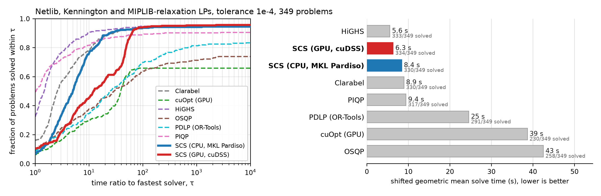
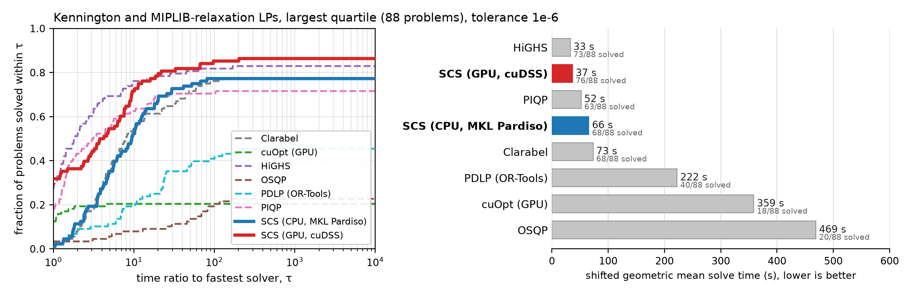
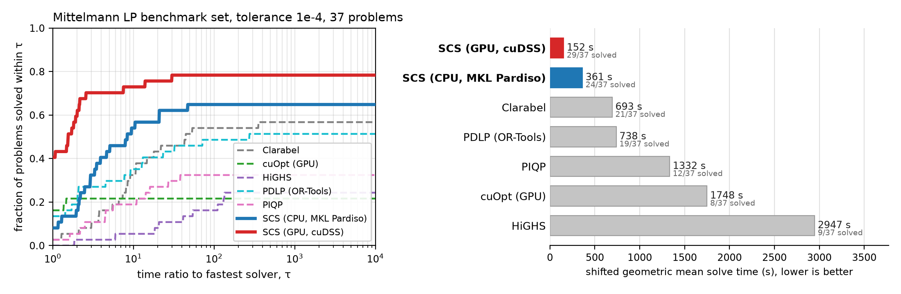
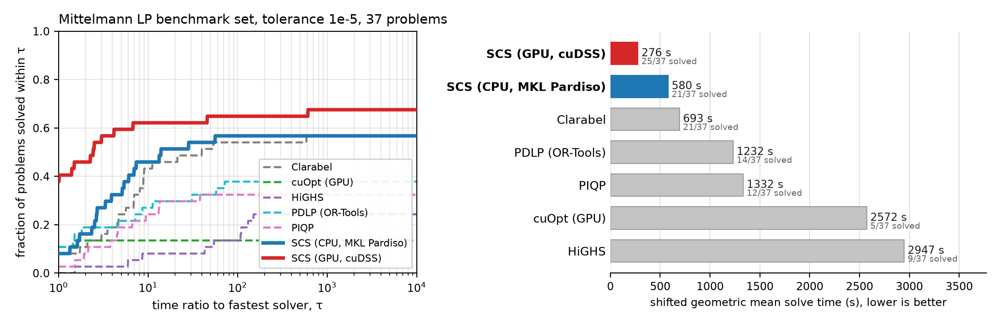
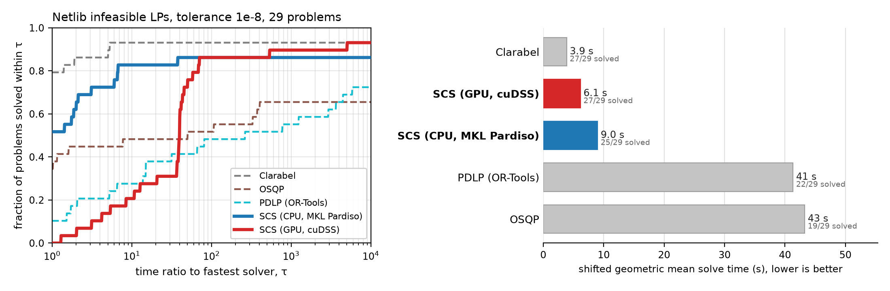
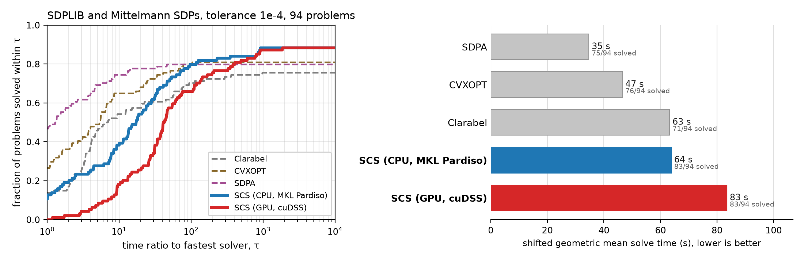

.. _benchmarks:

Benchmarks
==========

SCS 3.3 is fast on large problems and reliable across problem classes, and a
single solver covers linear, quadratic, second-order cone, semidefinite,
exponential cone and power cone programs. This page compares it with the
leading open-source solvers on standard quadratic program (QP), linear program
(LP) and semidefinite program (SDP) test sets, using the open
`solver_benchmarks <https://github.com/bodono/solver_benchmarks>`_ harness:
every solver gets the same problem in its native form and the same time limit,
and every solver, SCS included, has each returned solution checked
independently against the problem data. The raw results, the campaign
configuration and the scripts that make the figures and tables are in
`bodono/solver_benchmarks_results
<https://github.com/bodono/solver_benchmarks_results>`_ (campaign
``scs332_2026-11``), so every number here can be regenerated.

The highlights, at a target accuracy of :math:`10^{-4}` (SCS's default
tolerance):

* **Fastest on the largest problems.** With the cuDSS GPU backend, SCS has the
  lowest geometric mean solve time of any solver tested on the largest quarter
  of the QPs and on the largest quarter of the LPs, and it verifies all 40 of
  the largest QPs.
* **Large LPs.** On Hans Mittelmann's set of large LPs, SCS with cuDSS
  verifies 29 of the 37 instances, more than any other solver, in less than
  half the geometric mean time of the runner-up, SCS on the CPU. It is the
  only solver that solves ``Dual2_5000``, the largest instance, with 126
  million nonzeros.
* **Ahead of the other first-order and GPU solvers.** On every QP and LP set,
  both SCS backends verify more problems than OSQP, ProxQP, OR-Tools PDLP and
  NVIDIA cuOpt, in less time.
* **Competitive with interior-point solvers.** On the CPU, SCS verifies more
  of the largest LPs and of the Mittelmann LPs than any interior-point solver,
  in less time, and over all 349 LPs SCS with cuDSS verifies the most problems
  of any solver.
* **Semidefinite programs.** SCS verifies more of the 94 SDPs than any other
  solver shown (83 on both backends). On the 31 large sparse relaxations, SCS
  on the CPU and SDPA each verify 29, while Clarabel and CVXOPT hit memory,
  array-size or time limits on many of them.
* **Infeasibility.** SCS returns certificates of infeasibility or
  unboundedness that can be checked against the problem data. With cuDSS and a
  solve tolerance of :math:`10^{-8}` it certifies 27 of the 29 infeasible
  Netlib LPs, tied with Clarabel for the most.

Interior-point solvers are usually faster on small problems and on the SDPs
they can solve, and they pull ahead on QPs at tighter accuracy; the sections
below show where.

.. _bench_headline:

Headline results
----------------

The three rows a user of a large-scale solver is most likely to care about,
at a target accuracy of :math:`10^{-4}`: the largest quarter of the QP test
sets, the largest quarter of the LP test sets, and the Mittelmann large-LP
set. Left, the fraction of problems solved within a factor :math:`\tau` of the
fastest solver on each problem; right, the shifted geometric mean solve time
with the number of verified solves. SCS with cuDSS has the most verified
solves and the lowest geometric mean time in all three rows. The same figure
is on the front page; the sections below give the full test sets, the
tighter-tolerance results and the methodology.

.. figure:: ../files/bench/landing_grid.png
   :width: 100 %
   :align: center

.. _bench_method:

Methodology
-----------

**Verification.** No solver's "optimal" status is taken at face value. The
harness recomputes the relative primal residual, dual residual and duality gap
of every returned solution from the problem data, and a solve counts only when
all three are below ten times the target accuracy of the plot or table
(:math:`10^{-3}` for the :math:`10^{-4}` target), whatever tolerance the run
requested: a reported optimum that fails counts as a failure, and a return
reported inaccurate or timed out that passes counts as a success. Solvers
define "tolerance" differently, and first-order methods, SCS included,
occasionally stop on badly scaled problems where the unscaled residuals are
large, so the same independent check for every solver keeps the comparison
fair.

**Tolerances and the runs shown.** Each solver was run at two or three
requested tolerances, listed in the table below. SCS used its default settings
apart from ``eps_abs = eps_rel = tol``, the time limit and an iteration limit
raised to :math:`10^{6}`; its default tolerance, :math:`10^{-4}`, is the
headline target. A requested tolerance means different things to different
solvers, so at each target SCS, OSQP and cuOpt are shown from the run
requested at the target, and PDLP and ProxQP from their next tighter run where
there is one, which comes closer to the target in achieved accuracy. The
interior-point and simplex solvers are not loosened to the target: each is
shown from its tightest run, the one nearest its default accuracy
(:math:`10^{-6}`, and Clarabel's default :math:`10^{-8}` on the SDPs; PIQP and
HiGHS ran only at :math:`10^{-4}` on the Mittelmann set), so their verified
solutions are usually far more accurate than the target (second table below).
Their own defaults lie between :math:`10^{-6}` and :math:`10^{-9}`, each in its
own measure of the residual.

.. list-table:: Runs made (requested tolerance) and the run shown at each target accuracy; the 1e-4 target is used on every set, 1e-5 on the QP, LP and Mittelmann sets, and 1e-6 on the QP and LP sets
   :header-rows: 1
   :widths: 26 34 16 12 12

   * - Solver
     - runs
     - shown at 1e-4
     - at 1e-5
     - at 1e-6
   * - SCS (CPU and GPU)
     - 1e-4, 1e-5, 1e-6 (Mittelmann: 1e-4, 1e-5; SDP: 1e-4, 1e-6)
     - 1e-4
     - 1e-5
     - 1e-6
   * - OSQP (QP, LP)
     - 1e-4, 1e-5, 1e-6
     - 1e-4
     - 1e-5
     - 1e-6
   * - cuOpt (QP, LP, Mittelmann)
     - 1e-4, 1e-5, 1e-6 (Mittelmann: 1e-4, 1e-5)
     - 1e-4
     - 1e-5
     - 1e-6
   * - ProxQP (QP)
     - 1e-4, 1e-5, 1e-6
     - 1e-5
     - 1e-6
     - 1e-6
   * - PDLP (LP, Mittelmann)
     - 1e-4, 1e-5, 1e-6 (Mittelmann: 1e-4, 1e-5)
     - 1e-5
     - 1e-6 (Mittelmann: 1e-5)
     - 1e-6
   * - Clarabel
     - 1e-4, 1e-6 (SDP: also 1e-8)
     - 1e-6 (SDP: 1e-8)
     - 1e-6
     - 1e-6
   * - PIQP, HiGHS (QP, LP, Mittelmann)
     - 1e-4, 1e-6 (Mittelmann: 1e-4 only)
     - 1e-6 (Mittelmann: 1e-4)
     - 1e-6 (Mittelmann: 1e-4)
     - 1e-6
   * - SDPA, CVXOPT (SDP)
     - 1e-4, 1e-6
     - 1e-6
     - --
     - --

The table below gives the accuracy that the runs shown at the
:math:`10^{-4}` target actually achieved, measured the same way for everyone:
the largest of the three relative residuals over each solver's verified
solves.

.. list-table:: Achieved accuracy of the runs shown in the headline plots: median and 90th percentile of the largest relative KKT residual over each solver's verified solves (returns that fail the check are excluded for every solver)
   :header-rows: 2
   :widths: 20 10 11 11 11 11 11 11 11 11

   * - Solver
     - run
     - QP
     -
     - LP
     -
     - Mittelmann
     -
     - SDP
     -
   * -
     -
     - median
     - 90th
     - median
     - 90th
     - median
     - 90th
     - median
     - 90th
   * - SCS (CPU)
     - 1e-4
     - 7e-6
     - 1e-4
     - 3e-5
     - 9e-5
     - 7e-5
     - 9e-5
     - 9e-5
     - 1e-4
   * - SCS (GPU, cuDSS)
     - 1e-4
     - 1e-5
     - 9e-5
     - 3e-5
     - 9e-5
     - 5e-5
     - 1e-4
     - 9e-5
     - 3e-4
   * - OSQP
     - 1e-4
     - 5e-5
     - 1e-4
     - 6e-5
     - 1e-4
     - --
     - --
     - --
     - --
   * - PDLP (OR-Tools)
     - 1e-5
     - --
     - --
     - 9e-6
     - 1e-4
     - 2e-5
     - 2e-4
     - --
     - --
   * - cuOpt (GPU)
     - 1e-4
     - 4e-8
     - 3e-6
     - 6e-11
     - 7e-5
     - 6e-5
     - 5e-4
     - --
     - --
   * - ProxQP
     - 1e-5
     - 5e-6
     - 9e-5
     - --
     - --
     - --
     - --
     - --
     - --
   * - Clarabel
     - 1e-6 (1e-8 SDP)
     - 2e-7
     - 1e-6
     - 1e-7
     - 2e-6
     - 3e-7
     - 2e-6
     - 8e-8
     - 2e-6
   * - PIQP
     - 1e-6 (1e-4 Mittelmann)
     - 8e-10
     - 9e-8
     - 2e-10
     - 5e-8
     - 3e-10
     - 5e-6
     - --
     - --
   * - HiGHS
     - 1e-6 (1e-4 Mittelmann)
     - 5e-8
     - 9e-5
     - 7e-16
     - 1e-12
     - 1e-7
     - 3e-5
     - --
     - --
   * - SDPA
     - 1e-6
     - --
     - --
     - --
     - --
     - --
     - --
     - 2e-7
     - 5e-6
   * - CVXOPT
     - 1e-6
     - --
     - --
     - --
     - --
     - --
     - --
     - 3e-7
     - 2e-5

**Timing.** The reported time is wall-clock time for the solver call,
including any presolve, factorization and GPU transfer, but not reading the
problem from disk. The time limits are 300 s for QPs and LPs, 900 s for SDPs
and 1800 s for the Mittelmann LPs, passed to each solver's own time-limit
setting where it has one (PIQP, ProxQP, SDPA and CVXOPT have none, and the
harness stops them); a solve counts only if it finished within the limit plus
a 60 s grace. A performance profile shows the fraction of the problems each
solver solves within a factor :math:`\tau` of the fastest solver on each
problem, so the height of a curve at the right edge is the solver's success
rate. The shifted geometric mean uses a shift of 10 s and charges each failure
three times the time limit, more than any successful solve costs. Times below
10 ms are floored at 10 ms before computing ratios.

**Hardware.** Every solve ran on Modal, on one CPU type for the CPU solvers
and one GPU type for the GPU solvers, so that no solver's times depend on
which machine a job happened to land on (a container that started on any
other hardware handed its job back). The CPU solvers ran in 4-core Linux
x86-64 containers on AMD EPYC Zen 3 ("Milan") hosts, with every threading
library limited to 4 threads; SCS used MKL Pardiso, the linear system solver
the ``scs`` wheel selects by default on Linux (built from the 3.3.2 sources
against the same static MKL as the wheel). The two GPU solvers, SCS with
cuDSS and NVIDIA cuOpt, ran on an NVIDIA A100-SXM4-80GB with 8 cores of an
AMD EPYC Zen 3 host; their times include host-device transfer and cuDSS
analysis, so small problems pay a fixed overhead of roughly 0.4 s.

**Solvers.** SCS 3.3.2 (CPU with MKL Pardiso, and GPU with cuDSS 1.0.0),
Clarabel 0.11.1, PIQP 0.6.4, OSQP 1.1.3, ProxQP 0.7.3 (proxsuite), HiGHS
1.15.1, PDLP from OR-Tools 9.15, NVIDIA cuOpt 26.8.0, CVXOPT 1.3.3 and SDPA via
sdpa-python 0.2.3. Apart from SCS, each was the latest release on PyPI in
September 2026; every solver was run again for this page in November 2026, on
the hardware above. On the GPU, SCS ran cuDSS without pivoting, matching or
iterative refinement, so that, like the CPU direct solver, it computes a plain
LDL\ :sup:`T` factorization of the quasi-definite KKT matrix; this is the
change in `cvxgrp/scs#525 <https://github.com/cvxgrp/scs/pull/525>`_, which
the GPU build includes (see :ref:`cudss_solver`). Commercial solvers were not
included.

**Problem sets.** QP: Maros-Meszaros (138) and the QPLIB continuous convex
subset (19). LP: Netlib (feasible), Kennington and the root LP relaxations of
all 240 instances of the MIPLIB 2017 benchmark set; the Mittelmann LP set is
its own section. SDP: the 88 feasible SDPLIB instances and the 6 Mittelmann
SDPs. The 29 infeasible Netlib LPs and SDPLIB's four infeasible instances are
used only in :ref:`bench_infeasible`. "Largest quartile" means the quarter of
each family with the most nonzeros in the constraint matrix (plus the Hessian
for QPs).

**Exclusions.** Every failure counts against the solver, whatever its cause.
Clarabel exceeded the 64 GB memory limit on ``equalG11``, ``equalG51``,
``maxG55`` and ``G40mc`` in the September campaign, so with the same version
and memory it was not run on them again; its worker aborted on ``maxG60``.
cuOpt's QP path stopped with a numerical error on 47 of the 157 QPs in every
run, and its worker crashed on 14 of the 349 LPs in its :math:`10^{-4}` run;
PIQP's worker crashed on the QPLIB instance ``9008``. All of these count as
failures.

.. _bench_qp:

Quadratic programs
------------------

157 problems: Maros-Meszaros (138) and the convex continuous QPLIB instances
(19). On the largest quarter (the top row of the headline figure), SCS with
cuDSS has the lowest geometric mean time of any solver and verifies all 40,
and SCS on the CPU verifies 37, between Clarabel (38) and PIQP (35), and is
faster than PIQP. Both backends verify more than OSQP, ProxQP and cuOpt, in
less time. Over all 157 problems, most of them small, the interior-point
solvers Clarabel and PIQP verify a few more and are faster on most of the
smaller problems, where the GPU backend also pays its fixed overhead of about
0.4 s per solve.

.. figure:: ../files/bench/qp_1e-4_pair.png
   :width: 100 %
   :align: center

At the tighter :math:`10^{-6}` target the interior-point solvers pull ahead on
the largest QPs, as expected against a first-order method, but SCS with cuDSS
still verifies as many of them as Clarabel (34 of 40), and SCS remains the
fastest first-order solver by a wide margin.

.. figure:: ../files/bench/qp_1e-6_pair_largest.png
   :width: 100 %
   :align: center

.. list-table:: QP: verified solves and shifted geometric mean time (s); all 157 problems / largest quartile (40)
   :header-rows: 1
   :widths: 26 12 12 12 12 12 12 12 12

   * - Solver
     - solved 1e-4
     - gm 1e-4
     - solved 1e-4 (largest)
     - gm 1e-4 (largest)
     - solved 1e-6
     - gm 1e-6
     - solved 1e-6 (largest)
     - gm 1e-6 (largest)
   * - Clarabel
     - 153
     - 2.7
     - 38
     - 10.2
     - 148
     - 4.1
     - 34
     - 17.2
   * - PIQP
     - 151
     - 3.5
     - 35
     - 16.7
     - 151
     - 3.5
     - 35
     - 16.7
   * - SCS (GPU, cuDSS)
     - 148
     - 6.3
     - 40
     - 7.8
     - 141
     - 10.5
     - 34
     - 21.2
   * - SCS (CPU, MKL Pardiso)
     - 144
     - 7.7
     - 37
     - 15.9
     - 141
     - 9.5
     - 33
     - 23.5
   * - OSQP
     - 138
     - 10.9
     - 32
     - 29.6
     - 121
     - 27.8
     - 30
     - 42.6
   * - cuOpt (GPU)
     - 109
     - 32.8
     - 32
     - 19.9
     - 104
     - 38.0
     - 28
     - 32.2
   * - HiGHS
     - 107
     - 47.0
     - 17
     - 258.9
     - 84
     - 81.5
     - 10
     - 355.9
   * - ProxQP
     - 94
     - 73.5
     - 12
     - 342.2
     - 83
     - 92.0
     - 12
     - 352.9

.. _bench_lp:

Linear programs
---------------

349 problems: Netlib (93), Kennington (16) and the root LP relaxations of the
240 MIPLIB 2017 benchmark instances. On the largest quarter, SCS with cuDSS
verifies the most problems of any solver (82 of 88) and has the lowest
geometric mean time, ahead of HiGHS (dual simplex) and of the interior-point
solvers PIQP and Clarabel; SCS on the CPU verifies the second most and is
third in time, after HiGHS. Over all 349 LPs, SCS with cuDSS again verifies
the most (334), SCS on the CPU verifies as many as Clarabel (330) in less
time, and HiGHS has the lowest geometric mean time. OR-Tools PDLP and cuOpt
trail SCS by a wide margin under independent verification (see the notes
below). At :math:`10^{-6}`, SCS with cuDSS still verifies the most of the
largest LPs (76), with HiGHS the fastest. The first figure is the full
349-problem set at :math:`10^{-4}`; the second is the largest quarter at
:math:`10^{-6}`.

.. list-table:: LP: verified solves and shifted geometric mean time (s); all 349 problems / largest quartile (88)
   :header-rows: 1
   :widths: 26 12 12 12 12 12 12 12 12

   * - Solver
     - solved 1e-4
     - gm 1e-4
     - solved 1e-4 (largest)
     - gm 1e-4 (largest)
     - solved 1e-6
     - gm 1e-6
     - solved 1e-6 (largest)
     - gm 1e-6 (largest)
   * - HiGHS
     - 333
     - 5.6
     - 73
     - 32.6
     - 333
     - 5.6
     - 73
     - 32.6
   * - SCS (GPU, cuDSS)
     - 334
     - 6.3
     - 82
     - 19.6
     - 318
     - 12.3
     - 76
     - 36.5
   * - SCS (CPU, MKL Pardiso)
     - 330
     - 8.4
     - 79
     - 37.7
     - 313
     - 14.4
     - 68
     - 65.7
   * - Clarabel
     - 330
     - 8.9
     - 74
     - 58.4
     - 316
     - 12.0
     - 68
     - 73.2
   * - PIQP
     - 317
     - 9.4
     - 63
     - 51.8
     - 311
     - 10.7
     - 63
     - 51.8
   * - PDLP (OR-Tools)
     - 291
     - 24.6
     - 52
     - 136.6
     - 262
     - 38.9
     - 40
     - 222.4
   * - cuOpt (GPU)
     - 230
     - 38.7
     - 27
     - 230.7
     - 207
     - 54.7
     - 18
     - 358.6
   * - OSQP
     - 258
     - 42.5
     - 46
     - 218.1
     - 173
     - 132.0
     - 20
     - 469.0

.. _bench_lpbig:

Large linear programs: the Mittelmann set
-----------------------------------------

The LP test sets above are dominated by small and medium instances, so we also
ran the 37 problems of `Hans Mittelmann's LP benchmark set
<https://plato.asu.edu/ftp/lptestset/>`_, the standard collection of large,
hard LPs: between 100,000 and 126 million nonzeros, with several instances of
10 to 40 million variables. Every solver ran with an 1800 s limit in 64 GB
containers (4 cores, or an A100 80GB for the two GPU solvers) and is shown at
the target of :math:`10^{-4}` from the run chosen as described under
Methodology: Clarabel from its :math:`10^{-6}` run, PDLP from its
:math:`10^{-5}` run and the others from their :math:`10^{-4}` run. OSQP was
not run on this set. Mittelmann's own runs allow several hours per instance
and use faster machines, so the simplex and interior-point codes time out here
far more often than they do in his tables; the point of this set for us is
the size of the problems, not a re-run of his benchmark.

This is where the cuDSS backend pays off. SCS with cuDSS verifies 29 of the
37, more than any other solver, with a geometric mean time of 152 s: less than
half that of SCS on the CPU, which is second (24 verified, 361 s), and less
than a quarter of that of the best of the other solvers, Clarabel (21
verified, 693 s). It is the only solver that solves ``Dual2_5000``, the
largest instance, with 126 million nonzeros. OR-Tools PDLP, the other
first-order solver run on this set, verifies 19, and cuOpt, although it
reports 36 of the 37 instances optimal, verifies 8 (see the notes below).

The ordering is unchanged at the tighter :math:`10^{-5}` setting, at which
SCS, PDLP and cuOpt were also run on this set:

.. list-table:: Mittelmann LP set: verified solves out of 37 and shifted geometric mean time (s), tolerance 1e-4, 1800 s limit
   :header-rows: 1
   :widths: 40 20 20

   * - Solver
     - verified solves
     - geometric mean (s)
   * - SCS (GPU, cuDSS)
     - 29
     - 152
   * - SCS (CPU, MKL Pardiso)
     - 24
     - 361
   * - Clarabel
     - 21
     - 693
   * - PDLP (OR-Tools)
     - 19
     - 738
   * - PIQP
     - 12
     - 1332
   * - cuOpt (GPU)
     - 8
     - 1748
   * - HiGHS
     - 9
     - 2947

Failures specific to this set, all counted as failures: Clarabel exceeded the
64 GB memory limit on ``L1_sixm250obs`` in the run shown; OR-Tools PDLP
cannot load ``Dual2_5000`` and ``dlr2`` because the model exceeds the 2 GB
protobuf limit; SCS with cuDSS stopped with an allocation error while setting
up ``thk_48`` and ``L1_sixm1000obs``; cuOpt's worker crashed on ``qap15``, and
PIQP's on both ``L1_sixm`` problems. Four instances (``bdry2``,
``Linf_520c`` and the two ``L1_sixm`` problems) are distributed in Netlib's
compressed EMPS format and were decoded with ``emps`` before use.

.. _bench_infeasible:

Infeasible and unbounded problems
---------------------------------

A solver should also recognise when a problem has no solution, and SCS says so
with a certificate of infeasibility or unboundedness that anyone can check
against the problem data. We ran every LP solver on the 29 infeasible LPs of
the Netlib collection and every SDP solver on the four infeasible SDPLIB
instances (two primal infeasible, two unbounded). These are small problems, a
median of 460 variables, so this tests detection rather than speed at scale.

SCS with cuDSS certifies 27 of the 29 LPs, tied with Clarabel for the most,
and both SCS backends certify all four SDPs. At a solve tolerance of
:math:`10^{-4}`, SCS on the CPU certifies 23 of the LPs in 0.12 s geometric
mean, and most of the rest are near-feasible (defined below); with the solve
tolerance tightened to :math:`10^{-8}` it certifies 25, and 26 with the solve
and certificate tolerances both at :math:`10^{-6}`. Of the other solvers,
HiGHS detects 26 of the LPs by status, OSQP and PDLP give no answer on 10 and
5, and on the SDPs SDPA gets all four by status, while CVXOPT's certificates
fail the check.

SCS, Clarabel, OSQP, PDLP and CVXOPT return a certificate (a Farkas ray),
which the harness checks against the problem data at the same
:math:`10^{-3}` threshold as the plots; HiGHS, PIQP, cuOpt and SDPA report a
status only. A verified certificate of either kind counts as correct
(``cplex1`` and ``mondou2`` are both primal and dual infeasible).
"Near-feasible" means the solver returned a point whose residuals pass the
check: the instance is infeasible by less than the tolerance asked for. The
plot shows SCS, Clarabel and OSQP at a solve tolerance of :math:`10^{-8}` with
the certificate tolerance at :math:`10^{-4}` (a tight solve tolerance is what
stops a near-feasible point from being accepted as optimal), and PDLP at
:math:`10^{-5}` with its default certificate tolerance, which verifies more
than a loosened one. A verified certificate counts as a solve and everything
else as a failure, with the same charge as the other sets. The table shows
the same settings plus SCS at :math:`10^{-4}`; the other runs are in the
results repository.

.. list-table:: Infeasibility detection, Netlib infeasible LPs (29 problems): verified certificate / correct status without certificate / certificate failing the check / reported optimal with residuals within tolerance / wrong / no answer, and shifted geometric mean time (s) over certified and status answers
   :header-rows: 1
   :widths: 24 11 11 11 11 11 11 12

   * - Solver
     - certified
     - status only
     - unverified
     - near-feasible
     - wrong
     - no answer
     - gm time
   * - SCS (CPU, MKL Pardiso), 1e-4
     - 23
     - 0
     - 1
     - 4
     - 1
     - 0
     - 0.12
   * - SCS (CPU, MKL Pardiso), 1e-8 (infeasibility tolerance 1e-4)
     - 25
     - 0
     - 1
     - 1
     - 1
     - 1
     - 0.22
   * - SCS (GPU, cuDSS), 1e-8 (infeasibility tolerance 1e-4)
     - 27
     - 0
     - 0
     - 1
     - 1
     - 0
     - 1.97
   * - Clarabel, 1e-8 (infeasibility tolerance 1e-4)
     - 27
     - 0
     - 1
     - 1
     - 0
     - 0
     - 0.17
   * - PIQP, 1e-6
     - 0
     - 17
     - 0
     - 0
     - 0
     - 12
     - 0.31
   * - HiGHS, 1e-6
     - 0
     - 26
     - 0
     - 0
     - 0
     - 3
     - 0.01
   * - OSQP, 1e-8
     - 19
     - 0
     - 0
     - 0
     - 0
     - 10
     - 1.96
   * - PDLP (OR-Tools), 1e-5
     - 22
     - 0
     - 2
     - 0
     - 0
     - 5
     - 10.56
   * - cuOpt (GPU), 1e-4
     - 0
     - 28
     - 0
     - 0
     - 1
     - 0
     - 0.32

.. list-table:: Infeasibility detection, SDPLIB infeasible SDPs (4 problems): verified certificate / correct status without certificate / certificate failing the check / reported optimal with residuals within tolerance / wrong / no answer, and shifted geometric mean time (s) over certified and status answers
   :header-rows: 1
   :widths: 24 11 11 11 11 11 11 12

   * - Solver
     - certified
     - status only
     - unverified
     - near-feasible
     - wrong
     - no answer
     - gm time
   * - SCS (CPU, MKL Pardiso)
     - 4
     - 0
     - 0
     - 0
     - 0
     - 0
     - 0.04
   * - SCS (GPU, cuDSS)
     - 4
     - 0
     - 0
     - 0
     - 0
     - 0
     - 0.43
   * - Clarabel
     - 4
     - 0
     - 0
     - 0
     - 0
     - 0
     - 0.20
   * - CVXOPT
     - 0
     - 0
     - 2
     - 0
     - 2
     - 0
     - --
   * - SDPA
     - 0
     - 4
     - 0
     - 0
     - 0
     - 0
     - 0.03

.. _bench_sdp:

Semidefinite programs
---------------------

94 problems: the 88 feasible SDPLIB instances and the 6 Mittelmann SDPs. SCS
verifies more of them than any other solver shown: 83 on both backends,
against 76 for CVXOPT, 75 for SDPA and 71 for Clarabel. On the 31 large
sparse combinatorial relaxations (``theta``, ``mcp``, ``maxG``, ``qpG``,
``equalG`` and the Mittelmann ``G40mc``), SCS on the CPU verifies 29, as many
as SDPA, and SCS on the GPU 28, while CVXOPT verifies 21 and Clarabel 19,
hitting CVXOPT's ``INT_MAX`` array-size limit, the memory limit or the time
limit on most of the rest.

Where an interior-point solver does solve an SDP, it is usually faster: the
fastest of them beats SCS on the CPU on 73 of the 82 SDPs that SCS on the CPU
and at least one of them verify, and SDPA and CVXOPT have the lowest
geometric mean times, several times lower than SCS's on the largest quarter.
Most of SCS's failures are badly conditioned ``control`` and ``gpp``
instances, the truss design problems ``buck3`` and ``trto3``, and the two
largest max-cut relaxations, ``maxG55`` and ``maxG60`` (PSD blocks of order
5000 and 7000), which SDPA does not solve within the limit either. The GPU
backend does not help on SDPs: the time goes into the eigendecompositions of
the cone projection, not the linear system.

.. list-table:: SDP: verified solves and shifted geometric mean time (s); all 94 problems / largest quartile (24)
   :header-rows: 1
   :widths: 26 12 12 12 12

   * - Solver
     - solved 1e-4
     - gm 1e-4
     - solved 1e-4 (largest)
     - gm 1e-4 (largest)
   * - SDPA
     - 75
     - 34.7
     - 20
     - 45.5
   * - CVXOPT
     - 76
     - 46.6
     - 19
     - 86.9
   * - Clarabel
     - 71
     - 63.2
     - 12
     - 283.7
   * - SCS (CPU, MKL Pardiso)
     - 83
     - 63.8
     - 19
     - 404.5
   * - SCS (GPU, cuDSS)
     - 83
     - 83.5
     - 18
     - 624.8

.. _bench_sens:

Sensitivity to the requested tolerance
--------------------------------------

The headline plots target :math:`10^{-4}`. To show what a tighter target
costs, the same three rows are repeated with a target of :math:`10^{-5}`,
every solve verified at :math:`10^{-4}`, and each solver shown from the run
given for that target in the table under :ref:`bench_method`. The
interior-point and simplex solvers are shown from the same runs as at
:math:`10^{-4}`, but the tighter check still costs Clarabel and HiGHS some
solves.

.. figure:: ../files/bench/landing_grid_1e-5.png
   :width: 100 %
   :align: center

SCS with cuDSS keeps the lowest geometric mean time on the largest LPs and
still leads the Mittelmann set, where SCS on the CPU verifies as many as
Clarabel (21) in less time. On the largest QPs SCS with cuDSS still verifies
the most (38 of 40, against 37 for Clarabel), but two instances now reach the
time limit and Clarabel is slightly faster; PIQP and cuOpt are faster than SCS
on the CPU there. On the largest LPs OSQP and cuOpt lose about a third and a
quarter of their solves (46 to 32 and 27 to 20), and on the Mittelmann set
PDLP loses a quarter of its solves (19 to 14), against at most 14% for SCS on
those sets, so SCS's margin over them widens there. On the largest LPs PDLP
loses about as many as SCS (52 to 49), and on the largest QPs OSQP loses only
one (32 to 31).

.. list-table:: Verified solves and shifted geometric mean time (s) at the 1e-4 and 1e-5 settings; interior-point solvers unchanged (shown from their tightest run in both)
   :header-rows: 1
   :widths: 30 24 12 12 12 12

   * - Problem set
     - Solver
     - solved 1e-4
     - time 1e-4
     - solved 1e-5
     - time 1e-5
   * - Maros-Meszaros and QPLIB QPs, largest quartile (40)
     - Clarabel
     - 38
     - 10
     - 37
     - 11
   * - 
     - SCS (GPU, cuDSS)
     - 40
     - 8
     - 38
     - 12
   * - 
     - PIQP
     - 35
     - 17
     - 35
     - 17
   * - 
     - cuOpt (GPU)
     - 32
     - 20
     - 32
     - 20
   * - 
     - SCS (CPU, MKL Pardiso)
     - 37
     - 16
     - 34
     - 23
   * - 
     - OSQP
     - 32
     - 30
     - 31
     - 37
   * - 
     - HiGHS
     - 17
     - 259
     - 13
     - 302
   * - 
     - ProxQP
     - 12
     - 342
     - 12
     - 353
   * - Kennington and MIPLIB-relaxation LPs, largest quartile (88)
     - SCS (GPU, cuDSS)
     - 82
     - 20
     - 78
     - 28
   * - 
     - HiGHS
     - 73
     - 33
     - 73
     - 33
   * - 
     - SCS (CPU, MKL Pardiso)
     - 79
     - 38
     - 74
     - 51
   * - 
     - PIQP
     - 63
     - 52
     - 63
     - 52
   * - 
     - Clarabel
     - 74
     - 58
     - 70
     - 70
   * - 
     - PDLP (OR-Tools)
     - 52
     - 137
     - 49
     - 165
   * - 
     - cuOpt (GPU)
     - 27
     - 231
     - 20
     - 324
   * - 
     - OSQP
     - 46
     - 218
     - 32
     - 349
   * - Mittelmann LP set (37)
     - SCS (GPU, cuDSS)
     - 29
     - 152
     - 25
     - 276
   * - 
     - SCS (CPU, MKL Pardiso)
     - 24
     - 361
     - 21
     - 580
   * - 
     - Clarabel
     - 21
     - 693
     - 21
     - 693
   * - 
     - PDLP (OR-Tools)
     - 19
     - 738
     - 14
     - 1232
   * - 
     - PIQP
     - 12
     - 1332
     - 12
     - 1332
   * - 
     - cuOpt (GPU)
     - 8
     - 1748
     - 5
     - 2572
   * - 
     - HiGHS
     - 9
     - 2947
     - 9
     - 2947

Notes on individual solvers
---------------------------

* **cuOpt.** Run with its default LP method and default settings apart from
  the tolerance and time limit. It reports most LPs optimal (335 of the 349 in
  its :math:`10^{-4}` run), but 105 of those fail the infinity-norm residual
  check used here, 98 of them Kennington and MIPLIB problems with many
  variable bounds: its PDLP stops on an L2-relative rule, and on these
  problems its returned duals often have large infinity-norm stationarity
  residuals. The LP answers that pass are very accurate (median residual
  around :math:`10^{-10}`), and a tighter request changes little: its
  :math:`10^{-4}`, :math:`10^{-5}` and :math:`10^{-6}` runs verify 230, 232
  and 238 of the 349 LPs at :math:`10^{-3}`. Its QP path is a barrier method
  whose solutions verify cleanly.
* **PDLP (OR-Tools).** The same L2-relative termination rule applies, with a
  milder effect: at a requested :math:`10^{-4}`, 28 of its 307 "optimal" LP
  returns have infinity-norm residuals above :math:`10^{-3}`. It is shown
  from its :math:`10^{-5}` run, where 2 of 293 do.
* **HiGHS.** Its QP solver is an active-set method and is slow on the larger
  QPs; its LP simplex has the lowest geometric mean time over the full LP
  set.
* **ProxQP.** Run with its default dense/sparse backend selection; it times
  out on many of the larger problems.
* **Clarabel.** Shown from its :math:`10^{-6}` run on QP and LP and from its
  default :math:`10^{-8}` run on SDP. Each SDPLIB instance with a PSD block of
  order 500 or more that it was run on had a 64 GB container of its own.
* **SDPA and CVXOPT.** Interior-point SDP solvers, with the lowest geometric
  mean times on the SDP set. Neither takes a time limit, so the harness stops
  a solve that runs past it.
